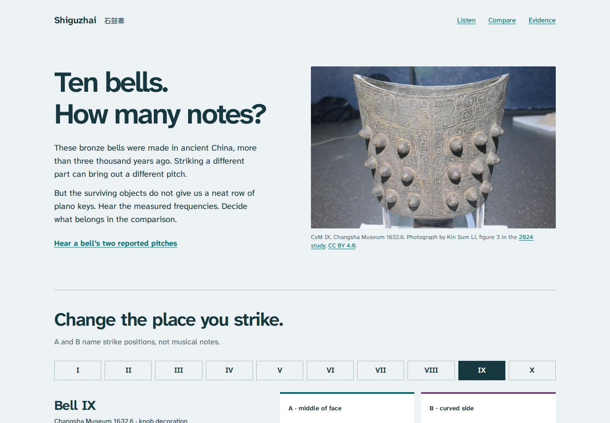

# Shiguzhai

**Ten ancient bronze bells. Hear the measurements; question the modern labels.**

[](LICENSE)
[](https://antonsoo.github.io/shiguzhai/)

A different strike position can bring out a different pitch in an ancient
Chinese bronze bell. But a surviving instrument does not supply a tidy pair of
modern notes. This exhibit lets you hear and inspect **all 87 reported frequency
entries** from ten Shiguzhai bells, compare their actual photographs, and change
the assumptions behind a count of musical notes.



[Open the exhibit](https://antonsoo.github.io/shiguzhai/) ·
[Try the 269 Hz observation](https://antonsoo.github.io/shiguzhai/?bell=I&a=280&b=269&group=burial&values=all&reference=440#listen) ·
[Saveable illustrated reading](examples/bell-I-reading.html) ·
[Printed reading](examples/bell-I-reading.pdf)

## Try this

1. Select bell I and choose its 269 Hz B observation. B names a strike position;
   it need not be higher than A. Hear 280 Hz followed by 269 Hz.
2. Keep all listed values. At the study's modern A4 = 440 Hz reference, the
   plotted values fall nearest to ten keys, compared with nine for leading entries.
3. Move the reference to 439 Hz. The same 269 Hz is now nearest C-sharp4 instead
   of C4; the full-list count becomes nine. The measurement marks stay still
   while the modern grid moves.

This is a classification change. It is not a change in the bells, evidence for
an ancient equal-tempered scale, or proof of the exact pitches heard in antiquity.
At 440 Hz, the 269 Hz observation is only about 1.9 cents from a key boundary.
The source gives integer frequencies without measurement error bars.

## What is here

- Ten museum objects from the June 1993 find, with source-order A and B lists,
  accessions, dimensions and the differently decorated bell III.
- Short reference tones for A, B, a pair, every reported B value, or B against
  its nearest modern key. All sounds are synthesized sine tones; none is a
  recording or a reconstruction of ancient bell timbre.
- Two independent grouping choices: same find versus similar decoration, and
  leading entries versus all observations. A movable modern grid makes the
  dependence of key labels on reference pitch visible.
- Real source photographs, the complete research paper, the printed table,
  an accessible HTML table with its footnotes, and three Chinese musical terms
  with explicitly modern Mandarin readings.
- Share links, PCM WAV, complete CSV and comparison JSON. The standalone HTML
  reading embeds photographs, the source page and its Chinese font; it opens
  offline and prints as an illustrated handout.
- Complete offline caching after the footer confirms it. No account, runtime
  dependency, analytics, remote font service or external request during use.

## Run locally

With Node.js 24 or newer, inside this checkout:

```sh
npm ci
npm run dev
```

Open `http://127.0.0.1:4350/shiguzhai/`. For the complete static site, run
`npm run build`; the output is `dist/`, with the base path `/shiguzhai/`.
`npm run preview` serves that build on the same port after stopping the dev server.

## How the comparison works

The data come from Li et al. (2024),
[_A “set” of ancient bronze bells excavated in Changsha, Hunan Province, China_](https://doi.org/10.1186/s40494-024-01377-0),
Table 1, page 6. The app transcribes the ten CsM columns, preserving museum
identity and list order. The first B entry is described as the clearest or most
often occurring; the first A is simply the first listed. Repeated frequencies
were omitted, so the entries cannot be treated as occurrence counts or a sequence
of strikes.

For a reported frequency `f` and chosen modern A4 reference `r`:

```text
continuous key number = 69 + 12 * log2(f / r)
nearest key           = round(continuous key number)
cents from that key   = 100 * (continuous key number - nearest key)
A-to-B interval       = 1200 * log2(B / A)
```

The plot uses a fixed logarithmic frequency axis. Changing `r` moves the reference
grid while preserving every measured position. Circle and diamond shapes encode
A and B independently of color. Every selected value must belong to that bell's
published list; malformed shared parameters fall back to valid observations.

The live player and WAV renderer share a finite Web Audio graph. Sine tones use
an attack/release envelope, and Stop cancels both sounding and scheduled tones.
An interrupted asynchronous audio resume cannot start stale playback. Exports
capture the settings at the time of the click. Source images and the embedded
font are checked against SHA-256 values before a reading is downloaded; the
service worker also checks complete-build asset integrity before activation.

## Verification

```sh
npm run check
npm run verify:source
npm run test:browser -- /tmp/shiguzhai-review/browser.json
```

The browser command requires Chromium and Firefox. Install them with
`npx playwright install chromium firefox` when needed.

| Evidence                                                 | What it independently checks                                                                                                      |
| -------------------------------------------------------- | --------------------------------------------------------------------------------------------------------------------------------- |
| [Source verification](docs/source-verification.json)     | Publisher HTML parsed in Python; every frequency, identity and dimension; modern pitches with 50-digit Decimal logarithms         |
| [Browser review](docs/browser-verification.json)         | Native controls, keyboard, desktop/375 px, exported artifacts, source substitution, accessibility and origin-disabled offline use |
| [Rendered verification](docs/rendered-verification.json) | Actual SVG coordinates against independent logarithmic calculations                                                               |
| [Audio verification](docs/audio-verification.json)       | Native browser PCM measured by interpolated zero crossings; silent gaps and amplitude envelopes                                   |
| [UI audio verification](docs/ui-audio-verification.json) | WAVs downloaded through the built interface, measured independently                                                               |

To check the browser report's rendered coordinates and its downloaded WAVs:

```sh
python3 scripts/rendered-oracle.py /tmp/shiguzhai-review/browser.json
python3 scripts/audio-oracle.py /tmp/shiguzhai-review/browser.json
```

For all source-frequency audio cases, keep the dev server running and use
`node scripts/audio-capture.mjs http://127.0.0.1:4350/shiguzhai/ /tmp/shiguzhai-audio`,
then `python3 scripts/audio-oracle.py /tmp/shiguzhai-audio/capture.json`.
See [the review record](docs/review.md) for observed results and limits.

## Accuracy and limits

These are modern measurements of surviving objects, not recordings from the
twelfth century BCE. The original experiment's accuracy, rounding, effects of
condition, casting intentions and ancient performance cannot be established by
this application. The grouping controls expose interpretive choices; they do not
settle the scholarly argument about a musical set. Counts refer to nearest
modern key labels, not the number of ancient pitches or scales.

The full paper and complete Table 1 retain two additional objects outside the
ten-bell comparison. The anatomy photograph is also a separately identified bell
from the 1959 find. The strike diagram is schematic, and the Chinese readings are
modern Mandarin. [Source and interpretation notes](docs/sources.md) explain these
boundaries and link the dictionaries and museum material.

## Contributing and licenses

See [CONTRIBUTING.md](CONTRIBUTING.md). Corrections should identify the object,
source passage and observable consequence.

New code, diagrams and teaching text are [MIT](LICENSE). Article material and
photographs retain CC BY 4.0 attribution; the source applies CC0 to its data.
Fonts remain SIL OFL 1.1. Full provenance and changes are listed in
[THIRD_PARTY.md](THIRD_PARTY.md).
