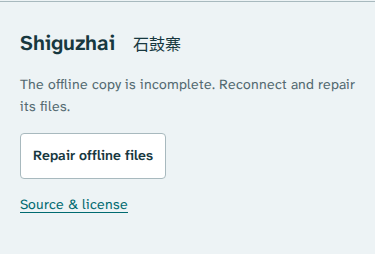

# Keep the evidence when the connection fails

This follow-up audit covers the reference investigation and both bell rooms.
It found reproducible failures in the saved-edition claim and export recovery,
then checked the repairs in Chromium and Firefox at 1440 and 375 px.

## What a learner can do

Open **Boundaries**, choose **Try the 269 Hz boundary**, and compare the same
reported frequency under two modern references. At 439.523 Hz the full list
occupies nine keys; at 439.524 Hz it occupies ten. Save the comparison with its
source images, complete frequency lists and Chinese font. The generated sound
keeps the reported 280 and 269 Hz frequencies on both sides.

The [original numerical and source review](reference-review.md) explains the
boundary, table-entry identities and limits. This audit keeps that lesson
usable when the connection or saved files fail.

## Findings and repairs

| Reproduced condition                                             | Earlier behavior                                                                   | Reviewed behavior                                                                                                   |
| ---------------------------------------------------------------- | ---------------------------------------------------------------------------------- | ------------------------------------------------------------------------------------------------------------------- |
| A cached source JPEG contains substituted bytes                  | Inventory reported complete; saved message remained                                | SHA-256 and length verification rejects it; both open rooms withdraw the saved claim                                |
| A saved source is deleted                                        | Manual worker inspection detected it, but both page messages remained saved        | Inspection and cross-tab messages update both rooms; explicit **Repair offline files** restores verified bytes      |
| The whole edition cache is evicted                               | No complete reading remains offline                                                | Read-only inspection leaves it absent; simultaneous repair requests share one job and restore the edition online    |
| Navigation receives HTTP 503 or a maintenance page with HTTP 200 | The error page replaced the cached lesson                                          | A verified cached room opens at the same URL                                                                        |
| Document headers or body stall                                   | Navigation did not recover within the reproduction's 4.5-second observation window | A two-second network window bounds the complete body, then uses the cached room                                     |
| Export source headers/body stall                                 | No cancellation or request deadline                                                | **Cancel** stops the export; each source has a twelve-second body deadline; controls recover without losing choices |
| Controls change while a reading is saving                        | A starting snapshot already existed                                                | The snapshot remains explicit: saved content keeps starting choices; later edits remain on screen                   |
| Older repair finishes after a new worker activates               | This race was not previously established                                           | The retiring worker cannot recreate its deleted edition cache                                                       |
| Desktop chart buttons use visible `CsM` labels                   | Spoken names omitted `CsM`                                                         | Names include the visible label and retain the museum accession                                                     |
| Craft export's own credit and bundled notices                    | Used the former author name                                                        | New exports and own notices identify Anthony Mercer                                                                 |

[Before reproduction](audit-before.json) and [after reproduction](audit-after.json)
retain the observed messages and inventory replies. The earlier reproduction
uses the feature edition before this audit; the previous public edition is
identified independently in [the upgrade receipt](audit-upgrade.json).



[The craft room's recovery controls](assets/audit-chromium-375-craft-repair.png).
The new actions use each room's existing design. Both repair states passed the
full automated accessibility scan and the checked horizontal-overflow bounds.

## Recovery evidence

[Worker audit](audit-offline.json) exercises actual cache substitution and
eviction, rejected wrong-but-200 repairs, two simultaneous repairs, all four
navigation failure modes in both rooms, keyboard repair and offline HTML export.
The HTTP fixture records that each intended document fault was actually reached;
the stall assertions require the timeout to elapse. This avoids mistaking an
unexercised network branch for a successful recovery.

The same audit installs a real replacement worker while a prior repair awaits
a retained PDF. Its next-edition fixture changes build identity only. The
retiring worker's response cannot recreate its cache; the older document offers
**Reload updated edition**, preserving its URL settings. A redundant worker may
stop answering messages; the audit checks the resulting cache state too.

[Upgrade from the public edition](audit-upgrade.json) starts with all 37 files
independently matched at their canonical public URLs. Two rooms remain open
while the new edition's source download is held for five seconds. The new page
reports downloading; the old room reports an edition mismatch after activation.
With the local fixture's origin then disabled, both rooms reload with their
selected state and save complete native HTML readings. This is a controlled
upgrade observation; it does not by itself establish a new public deployment.

[Export recovery](audit-export-recovery.json) covers both rooms, both engines
and both widths: cancellation before response headers, stalled response bodies,
start-time snapshots during later edits, and refusal of substituted source bytes.
Service workers are blocked in these cases to exercise the raw fetch failures.

## Check the source again

The fresh [Li et al. publisher PDF](https://www.nature.com/articles/s40494-024-01377-0.pdf)
is byte-identical to the retained 2,762,411-byte paper. Poppler layout extraction
of its printed page 6 independently recovers the twenty A/B lists, including
their order, and matches all **87 entries** against the separately parsed
publisher HTML. [Source-table receipt](audit-publisher-table.json).

The [Takahashi publisher PDF](https://www.jstage.jst.go.jp/article/ast1980/10/5/10_5_299/_pdf)
was freshly downloaded and its printed Tables 1 and 2 on pp. 300-301 inspected.
A [separate manual fixture](../scripts/fixtures/takahashi-tables.csv) checks all
fourteen dimension rows, reported masses, twenty-four resonances and printed
relative cents against the retained measurement JSON. The two ROM objects keep
their unreported masses and pitch pairs absent. This is a manual transcription
check, not OCR or a repetition of the acoustic experiment. The online review
also checks the exact Wikisource revision behind all six Chinese selections.
[Craft source receipt](audit-shuang-sources.json).

The modern reference calculation still matches an independent **60-digit**
calculation over **137 boundaries and 9,068 entry pairs**.
[Numerical receipt](audit-reference-oracle.json). No measurement error bars,
ancient reference pitch, ancient equal temperament or original bell timbre are
inferred. The decimal reference controls locate a classification boundary.

## Files and ordinary operation

[Reference browser receipt](audit-reference-browser.json) covers all four filter
scopes, keyboard boundary navigation, direct links, held/current values, unchanged
WAVs, actual downloads, disconnected operation and script-free readings opened
from disk. [Artifact review](audit-reference-artifacts.json) independently checks
the actual CSV intervals and all SVG segments against the source frequencies,
plus the five-page printed reading's text and word bounds. The current HTML
reading is byte-identical to the [retained example](../examples/reference-reading.html.gz).

[Craft browser receipt](audit-craft-browser.json) covers fourteen object choices,
all six readings, audio PCM against the downloaded WAV, missing pitches and the
native saved study. Its intentional damaged-source case expects the worker's
HTTP 503 refusal, permits only that expected resource error and forbids a download.
The refreshed [HTML](../examples/shuang-study.html) and
[twelve-page PDF](../examples/shuang-study.pdf) retain the corrected credit.
[PDF inspection](audit-craft-print.json) extracts all 36 complete Chinese,
English, word, pinyin, gloss and note fields and recovers the museum JPEG byte
for byte. Both PDFs are untagged; physical printing remains unverified.

Original-room checks still cover **48 rendered charts, 2,412 marks and eight
measured WAV tones**, with silent gaps and envelopes checked separately.
[Rendered-coordinate receipt](audit-rendered-oracle.json) and
[audio receipt](audit-audio-oracle.json).

[Fresh Node 24 build](audit-clean-build.json): a source archive, fresh `npm ci`
and `npm run check` produced all **37 files byte-identically** to the reviewed
production output. This includes thirteen unit checks, lint and type checking.
The later HTTP-fixture correction changes verification code, with no production
input change. Local checks, source synchronization, hosted bytes, browser
behavior and remote CI are separate claims.

## Reproduce

```sh
npm ci
npm run check
npm run verify:publisher-table
npm run verify:reference
npm run test:offline -- /tmp/shiguzhai-offline-audit
npm run test:export-recovery -- /tmp/shiguzhai-export-recovery
npm run test:reference -- /tmp/shiguzhai-reference-review
python3 scripts/reference-artifacts.py /tmp/shiguzhai-reference-review
python3 scripts/shuang-source-review.py --online
```

Python 3, Poppler and installed Playwright Chromium/Firefox are needed for the
source and browser commands. `npm run build` writes `dist/` for `/shiguzhai/`.
The Pages workflow preserves earlier hashed assets for a reader whose entry
page is cached. Deployment and public discovery require separate verification.
