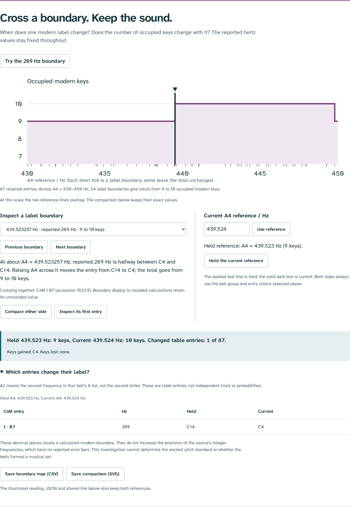

# Cross a boundary; keep the sound

This extends the original Shiguzhai comparison in its existing room. Select
**Boundaries**, then **Try the 269 Hz boundary**. It keeps all the reported
frequencies fixed while changing the modern grid used to name them.

The implementation and examples have been reviewed locally. Publication of
this addition is reserved for the coordinator by `HOUSE_STANDARDS.md`. An
existing public page can therefore differ from this checkout. No deployment,
remote CI result or registry release is claimed here.

## What a learner can do

1. Keep the June-find group and every listed frequency. Compare the two sides
   of the boundary at A4 = 439.52325692185593… Hz.
2. At the held A4 of 439.523 Hz, the reported 269 Hz entry is nearest C-sharp4;
   at the current 439.524 Hz, it is nearest C4. The total rises from nine to ten.
   The changed-entry table identifies **CsM I, B7**, accession **1632.9**.
3. Download the selected A/B WAV on both sides. It is byte-identical within
   each engine: 280 Hz followed by 269 Hz. The reference grid changed;
   the reported frequencies and their plotted positions did not.
4. Choose a different boundary. Many change one or more labels while retaining
   the total. Repeated frequencies in separate table entries cross together
   without losing their object, position or list index.
5. Hold a reference, move the current one, and change the object/entry filters.
   Both sides always use the current filters, as stated beside the controls.
   Holding a reference does not freeze a separate object selection.
6. Keep the comparison in a shared link, JSON or illustrated reading. Save
   the complete interval map as CSV or the current comparison as SVG.

**B7** means the seventh value in bell I's published B list. It is not a seventh
strike, an independent acoustic trial, a probability or a reconstructed ancient
note. The source omits repeated frequencies and gives no occurrence counts.



[Operated phone layout](assets/reference-phone.png). The phone ruler has its
own readable coordinate layout. Its comparison table keeps both key labels
visible. Closely separated references overlap on the full-range ruler; the
written values preserve their difference. The diagram is intentionally not
an enlarged claim about the precision of the bells' acoustic measurements.

## Source identity and scope

The measurement source is Kin Sum Li and colleagues, _A “set” of ancient bronze
bells excavated in Changsha, Hunan Province, China_, _Heritage Science_ 12, 264
(2024), Table 1, printed p. 6, [DOI 10.1186/s40494-024-01377-0](https://doi.org/10.1186/s40494-024-01377-0).
It is a modern measurement study of surviving ancient objects.

A fresh [publisher PDF](https://www.nature.com/articles/s40494-024-01377-0.pdf)
download was byte-identical to the retained complete paper:

```text
SHA-256 431eacc7f75f338349109161f320bd9f1a6e22da7b13db33fab5f759cbb72edd
```

The complete table page was rendered and inspected, including its twenty A/B
frequency lists, table-order priorities, 22-degree testing context and modern
A4 = 440 Hz note. [Source receipt](reference-source.json).
The original source checker independently parses the publisher's retained HTML
table, checks all 87 entries, object identities and dimensions, and compares
the pitch calculations with 50-digit Decimal logarithms.

The new investigation changes no reported measurements or source passages.
Its decimal places locate a calculated modern reference boundary. No error
bar, rounding distribution, ancient reference pitch, performance practice or
musical scale is inferred. The 430–450 Hz range is the original exhibit's modern
comparison range, not a historical interval estimated by the source paper.

## Calculation

For reported frequency `f`, A4 reference `r` and integer modern key `k`:

```text
continuous key = 69 + 12 log2(f / r)
nearest key    = round(continuous key)

boundary between k and k+1:
              r = f / 2^((k + 0.5 - 69) / 12)
```

Increasing `r` decreases the continuous key for a fixed `f`. Thus an entry moves
from `k+1` to `k` as the reference rises across this boundary. At an exact tie,
the higher key is chosen. The implementation handles floating-point roundoff
within `1e-12` of a half-step consistently with that convention.

Solve every boundary in range for every selected source entry; group identical
frequency/key boundaries while retaining the entries separately. Sorted
boundaries partition the continuous range. Classify one interior reference
per interval, where every entry's label is constant. This enumerates the full
map without guessing its shape from a sampled sweep.

| Current object/entry choice             | Retained entries | Label boundaries | Minimum keys | Maximum keys |
| --------------------------------------- | ---------------: | ---------------: | -----------: | -----------: |
| Ten bells, leading entries              |               20 |               17 |            7 |            9 |
| Ten bells, all entries                  |               87 |               54 |            9 |           10 |
| Nine similarly decorated bells, leading |               18 |               17 |            7 |            9 |
| Nine similarly decorated bells, all     |               76 |               49 |            9 |           10 |

These are counts of occupied modern labels, not counts of ancient scale tones.
Equal totals can hide changed labels; extra entries need not create extra keys.

## Files that leave the site

The samples are actual browser downloads, rather than separately generated
demonstrations. The PDF was printed from the downloaded HTML with scripts
disabled. The gzip file contains the original HTML bytes.

| File                                                        | Retained content                                                                                                                  |
| ----------------------------------------------------------- | --------------------------------------------------------------------------------------------------------------------------------- |
| [HTML reading, gzip](../examples/reference-reading.html.gz) | Both references, graph, changed entries, readings, all frequency lists, original source JPEGs, Chinese font and full font license |
| [PDF](../examples/reference-reading.pdf)                    | Five printed A4 pages, including the comparison and complete table page                                                           |
| [CSV](../examples/reference-boundaries.csv)                 | All 55 intervals, 73 crossing-entry records at the 54 boundaries, and all 87 held/current entry comparisons                       |
| [SVG](../examples/reference-comparison.svg)                 | Count profile, both references, changed entry and source/model limits                                                             |
| [JSON](../examples/reference-comparison.json)               | Settings, source identity, complete analytical map and separate held/current labels                                               |

In the CSV, `interval` records use `a4_hz` and `upper_a4_hz` for their bounds;
`boundary` records use `a4_hz` for the calculated crossing; `comparison` records
use the two columns for held/current references. The `record` column identifies
these meanings. Interval bounds carry inclusion flags: the first includes
430, later lower bounds are excluded, and upper bounds are included under the
higher-key tie convention. Decimal CSV values are finite representations of
the computed boundaries.

Older shared URLs remain valid with a default held reference of 440 Hz. Both
reference settings are bounded to 430–450 and retained to 0.001 Hz. That control
resolution brackets every boundary in this particular data set, including its
closest neighboring boundaries, about 0.006343 Hz apart. No JSON import or
automatic browser persistence is asserted by this exhibit.

## Observed verification

[Independent numerical receipt](reference-oracle.json): a separate 60-digit
Python calculation reads the publisher table, checks all **137** boundaries
across four scopes, every interval and **9,068** entry pairs. Its largest
boundary discrepancy is below `8e-14` Hz.

[Production browser receipt](reference-browser.json): Chromium and Firefox at
1440 and 375 px exercise direct fragments, keyboard entry and boundary navigation,
first/last boundaries, all four scopes, label changes with unchanged totals,
held/current references, real downloads and native source inspection. No page
errors, external runtime requests or checked WCAG A/AA violations were observed.
Both rooms and new HTML export work after disconnecting. A fresh context opens
the saved reading with JavaScript disabled and makes no HTTP requests.

[Native artifact receipt](reference-artifacts.json): independently parses all
downloaded CSVs against the publisher frequencies and high-precision logarithms,
locates every actual SVG segment using its written axis, and checks the five-page
PDF's key passages and extracted word bounds. Source JPEGs and the Chinese font
are retained byte for byte in HTML. The PDF is untagged; physical printing and
assistive-technology reading of that PDF are unverified.

[Clean-build receipt](reference-clean-build.json): a fresh archive of the feature
commit was installed and checked with Node 24.22.1. All **37** output files match
the browser-reviewed build byte for byte. This identifies the local edition;
it does not establish that those bytes have been deployed.

[Existing-room regression receipt](reference-regression.json): all original
listening flows run in both engines at both widths. Independent checks cover
48 rendered charts, 2,412 plotted marks, eight measured WAV tones, silent gaps
and envelopes. The Piao-shi room still operates all fourteen object selections,
keeps the two unreported pitch pairs absent, and matches native Web Audio PCM
with its WAV. Later edits affected only the new comparison's table and wording.

Reproduce from the checkout with Python 3, Poppler's `pdftotext`, and installed
Playwright Chromium and Firefox:

```sh
npm ci
npm run check
npm run verify:reference
npm run test:reference -- /tmp/shiguzhai-reference-review
python3 scripts/reference-artifacts.py /tmp/shiguzhai-reference-review
```

The ordinary `npm run verify:source` and `npm run test:browser` commands retain
their source and original-room roles. `npm run build` writes the complete
two-room static edition to **`dist/`**, with base **`/shiguzhai/`**. The workflow
contains these checks; their local results are separate from remote CI.

Suggested repository description: **Investigate ancient Chinese bells through
reported frequencies, reference boundaries and a Chinese craft text.**
Suggested topics: `ancient-music`, `chinese-bells`, `archaeology`, `acoustics`,
`history-of-science`, `education`, `typescript`.
